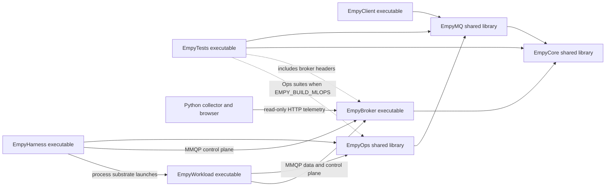

# Architecture and ownership

The implementation completes the current skeleton rather than importing the older
checkout's target layout. Generic runtime and wire/transport utilities remain in
Core; the client library owns client policy and payload keys; broker logic remains
header-implemented in the broker executable's existing include tree.

`EmpyOps`, `EmpyHarness` and `EmpyWorkload` are the optional Agentic-MLOps
extension (`EMPY_BUILD_MLOPS`). They use only the public client API (`eMQ::Client`
modules) and never the broker headers. [MLOPS.md](MLOPS.md) documents them.

| Component | Owns | Does not own |
| --- | --- | --- |
| `eCore::ImplRuntime` / `ImplService` | Application loop, modules, generic ECS/event/timer/worker registries | Transport-specific implementation or payload keys |
| Core `MMQP::Codec`, `ProfileTable`, `AliasMap`, receive/pending windows | Checked packet and protocol state primitives | Application callbacks or routing policy |
| Core `IoContext`, `Connection`, `IoTimer` | Serial transport executor, sockets, TLS/QUIC lifetimes, I/O queues | Application ECS/events |
| `eMQ::Service` / `Client` | Client session state, futures, profiles, retries, payload cipher, failover | Broker routing/storage |
| `eMQ::Server::Service` / `Broker` | Sessions, admission, routing trie, retention, durable broker state | Payload decryption keys |
| `FabricNode` and cluster stores | Backplane, manifests, profiles, leases, inboxes and replica state | Application-facing client API |
| `ClusterNode` / `Monitoring` modules | Optional service lifecycle integration | Independent duplicate protocol engines |
| Dashboard collector | Bounded cached telemetry, rates/history, query pages | Broker mutations or application data |
| `eOps::Fabric::Bus` / `BusModule` | Envelope publish/listen, request serving, correlated Call/Gather with sweep-driven timeouts on one client's owner thread | Broker routing or the client session itself |
| `eOps::Harness::ExecutionHarness` | Workflow state machines, `StateStore` (deployments, workflows, reservations), scheduler, Guard checks, health events, substrate enactment | Agent reasoning; the workloads' data plane |
| `eOps::Harness::AgentHost` and `eOps::Agents` cores | Executive, Placement, Lifecycle and Compliance reasoning on workers; event-driven proposals | Infrastructure changes: they only answer requests and propose workflows |
| `eOps::Context::KnowledgePlane` / `Comas` | CoMaS collections, retrieval, memory consolidation, MCP binding (internally synchronised) | Harness execution state |
| `eOps::Substrate` implementations | Simulated records, `EmpyWorkload` child processes, rendered Kubernetes manifests | Validation: they enact only Guard-approved specs |
| `eOps::Workload` runtimes (`EmpyWorkload`) | Inference with the execution boundary, training, simulated telemetry, heartbeats and events | Lifecycle decisions: model loads come from the harness |

## Thread boundaries

An application Runtime has an owner thread. It constructs the runtime, attaches
modules/listeners, manipulates its public ECS, and calls `Poll`, `Start`, or
`StartLoop`. Network and worker threads hand work to it through the bounded
dispatch queue. `On`, `Invoke`, module changes, and registry mutation are owner
operations. `Shutdown` must run on the owner, not inside an I/O or worker callback.

One protocol service owns one `IoContext` strand. All connections, timers, protocol
maps and broker routing state of that service run serially there, even when more
than one I/O worker is configured. The broker's **private protocol ECS** is confined
to this actor; the application's public ECS remains confined to its owner thread.
This is an explicit implementation binding for the PDF's registry architecture:
the two registries are not shared across threads. It lets a CLI or an application
waiting on a future continue servicing network traffic without invoking user
callbacks on a networking thread. It also means one broker actor has a serial CPU
ceiling; independent brokers provide protocol parallelism. No linear scaling claim
is made for increasing `workers` on one actor.

The fabric has a separate I/O context. Synchronous broker-to-fabric calls wait for
bounded RPC rounds on that independent context; native callbacks never wait for
the application loop. A durable routing/admission operation can therefore delay
other sessions on that broker actor for its RPC/storage latency. This simple
ownership model trades that serialization for deterministic commit-before-effects
and straightforward recovery. Expensive application work belongs in `Async` and
must dispatch its registry changes back to the owner.

`IoContext::Post` has task-count and byte budgets. Payload-bearing client calls
charge retained bytes before enqueueing. It throws on a stopped/full executor;
shutdown control has its own guaranteed admission path. `Submit` executes inline
when already on the same strand, otherwise returns a packaged-task future. The
caller must not block an actor on an operation that depends on that actor itself.

The MLOps extension keeps these rules. Its `Bus` handlers, harness workflow steps
and workload runtimes run on their client's owner thread inside `Poll`. Bus
timeouts are driven by a sweep in `BusModule`, not by timers that the calling
module owns. Work that blocks goes to `Async` workers and returns through
`Dispatch` under an alive flag: agent cores (including any LLM call), substrate
deploy/retire/list operations, and training fits. A detached module therefore
never receives a late completion. Agent cores hold a per-role mutex, and those
that use the shared ontology also hold one ontology mutex. `StatusServer` reads a
copied snapshot on its own thread. Operator commands (`EmpyHarness intent`,
`deploy`) submit with `wait: false` and poll Status, so no single exchange spans a
whole workflow.

## Message and callback lifetime

`SharedBytes` owns one reference-counted payload allocation. Forwarding and retry
frames retain it through `WireFrame::m_Tail`; small headers live in an inline
buffer. TCP uses gathered buffers, with bounded batching. Small TLS messages share
a staging record; large TLS messages retain gathered payload ownership. Native
QUIC send buffers live through their completion callbacks. Encryption, wire
decoding into owned payloads, and durable snapshots still require copies; this is
not an end-to-end zero-copy claim.

Codec views such as `PacketSummary::m_Topic` and spans passed to transport receive
callbacks are borrowed only for that callback/frame lifetime. Decoded application
`Receive` events own their topic and share their payload. Do not retain an event
reference beyond the callback; copy/move the needed values instead. Mutating
`SharedBytes::MutableData` is permitted only while uniquely owned, before sharing.

Application events include `Connect`, `Disconnect`, `Session`, `Profile`,
`Publish`, `Delivery`, and `Receive`. Topic-filtered `On` accepts `Receive`,
`Publish`, and `Profile`. Network code uses nonblocking `TryPost`: a full receive
queue causes connection failure before QoS 1 acknowledgement, allowing retry.
Informational observation events may be dropped when their queue is full;
operation futures remain authoritative for acceptance. Poll the owner regularly.

## Lifecycle and cleanup

- Worker threads start lazily on first `Async`, with a bounded queue. Stopping a
  pool from its own worker is rejected to avoid detached callbacks using freed
  state.
- Runtime initialization, start and release hooks run once. `Shutdown` also
  releases runtimes driven solely by `Poll`. Failed module attachment cleans up
  owned timers/listeners, and module teardown runs in reverse attachment order.
- Shutdown fences new I/O submissions, cancels service timers, drains native QUIC
  completions while its actor is alive, closes sockets, and joins workers. The
  context outlives its timers/connections. External callers must finish using the
  service before destroying it.
- Ordinary callback exceptions are logged/contained; futures carry task errors.
  Event registry cleanup remains valid when listeners remove themselves or throw.
  One poll bounds work from timers that reschedule immediately.
- Process signals only write `sig_atomic_t`; the CLI owner loop performs cleanup.

## Resource and persistence policy

Defaults bound sessions, profiles, in-flight publications, requests/responders,
send queues, retained/replay bytes, storage records, RPC rounds, and telemetry.
Receive windows remain 256 publications; a smaller configured send limit does
not shrink duplicate receipts. Pending sequence distance also stays inside that
window even when acknowledgements arrive out of order. Full resources produce
explicit errors/backpressure rather than unbounded growth or silent reliable loss.

`FileStore` uses an exclusive directory owner lock, bounded reads, checksums,
flush-before-success, and atomic snapshot replacement. Journals tolerate an
incomplete trailing record; a complete record with an invalid checksum fails
closed, including the last record. Broker state commits before acknowledgements
and deferred routing effects. Actual durability depends on local filesystem and
device flush semantics; the storage is not a distributed filesystem abstraction.

The subscription trie avoids a full subscription scan per publication. Aliases
reduce repeated topic bytes after confirmation. Payload sharing avoids a copy per
recipient. These are implementation properties, not measured throughput gains.

## Source conventions

Project C++ uses Allman braces, four spaces, PascalCase types/methods, and `m_`
members; `.clang-format` and `.clang-tidy` record the conventions. Required external
contracts retain their names, such as `main`, chrono's `now`/`time_point` and EnTT's
`in_place_delete`. Vendored code retains upstream formatting and licenses. JSON
and YAML field names remain stable regardless of C++ member names.
