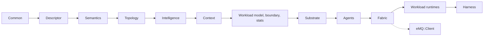
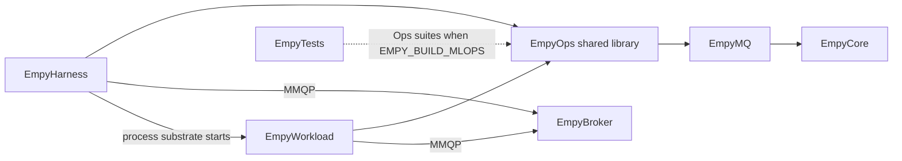
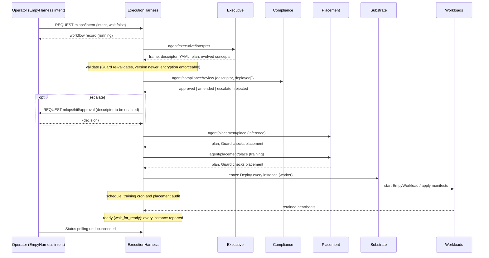
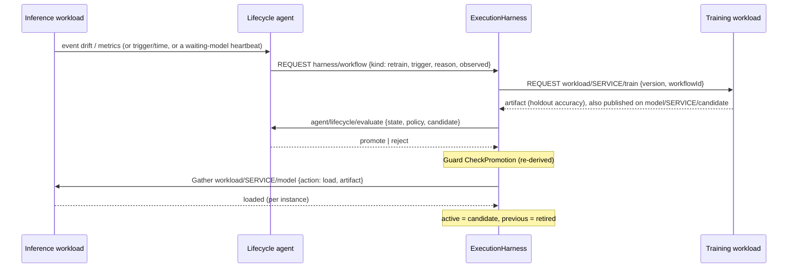
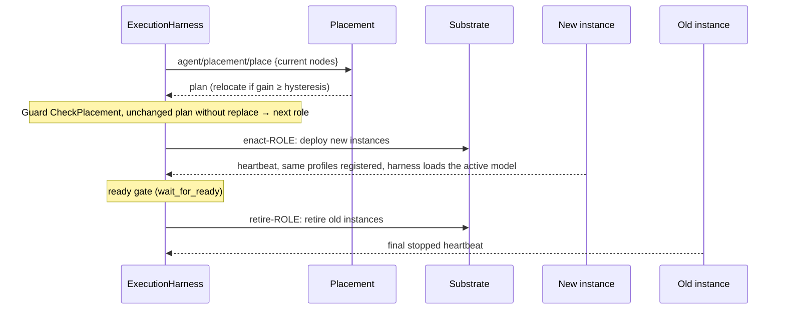
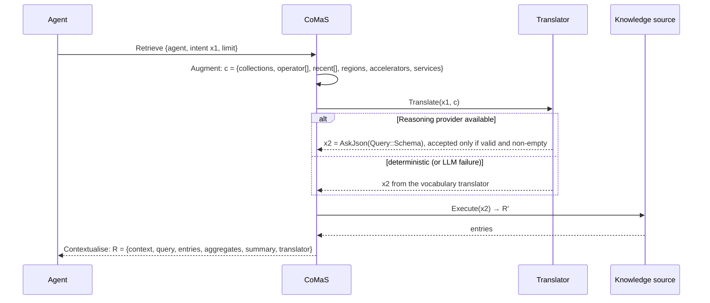

# Agentic-MLOps extension

The Agentic-MLOps extension implements the thesis section **2.1 MLOps Framework**
([README.pdf](../README.pdf), physical pages 47-55) on top of the EMPY/MMQP framework. ML workflows are MMQP communication entities:
deployment, lifecycle, retraining triggers and governance are topic profiles,
publish/subscribe and correlated request/response over one configurable topic root.
Workflow execution is deterministic; agents may consult an LLM, but every proposal
is validated against the declared execution boundaries before anything is enacted.

The extension adds one shared library and two executables. The original five
targets are unchanged, and `EMPY_BUILD_MLOPS=OFF` builds them without it.

| Target | Kind | Purpose |
| --- | --- | --- |
| `EmpyOps` (`EMPY_LIB_OPS`, `EmpyOps.dll`) | shared library, PUBLIC `EmpyMQ` | Descriptor, ontology, topology, intelligence providers, CoMaS, workload runtimes, substrates, agents, MMQP binding, harness |
| `EmpyHarness` (`EMPY_EXE_HARNESS`) | executable | Harness runtime and agent swarm (`run`), operator commands, offline tools, MCP server |
| `EmpyWorkload` (`EMPY_EXE_WORKLOAD`) | executable | Reference inference, training and simulator workloads of a RichML-Service |

Quick start: [Running locally](#running-locally). Build options are in
[BUILDING.md](BUILDING.md) and executed results in [VALIDATION.md](VALIDATION.md).

## Contents

1. [Thesis mapping](#thesis-mapping)
2. [Modules, targets and threads](#modules-targets-and-threads)
3. [RichML-Service descriptor](#richml-service-descriptor)
4. [MMQP topic and message contract](#mmqp-topic-and-message-contract)
5. [Workflows](#workflows)
6. [Agents](#agents)
7. [CoMaS context management](#comas-context-management)
8. [Intelligence providers](#intelligence-providers)
9. [Execution substrates](#execution-substrates)
10. [Configuration reference](#configuration-reference)
11. [Command-line reference](#command-line-reference)
12. [Running locally](#running-locally)
13. [Operating with a real LLM](#operating-with-a-real-llm)
14. [Deploying to Kubernetes](#deploying-to-kubernetes)
15. [Boundaries and qualification limits](#boundaries-and-qualification-limits)

## Thesis mapping

Sources are under `EMPY_LIB_OPS/include/eOps` (headers) and `EMPY_LIB_OPS/src`
(implementations). Suites are CTest suites of `EmpyTests` (`EMPY_EXE_TESTS/src/Ops`).

| Thesis requirement | Implementation | Main validation |
| --- | --- | --- |
| 2.1.1 RichML-Service: self-describing ML BoM (Listing 2.1) | `Descriptor/Model.h`, `Parser.h`, `Profiles.h`; `Configs/MLOps/HomeControl.yaml` | `OpsDescriptor` (Listing21, ShippedDescriptors, EmitRoundTrip, Profiles) |
| Observables = subscription profiles, actionables = bounded publication profiles | `Descriptor/Profiles.h`, `Validator.h`; `Workload/Boundary.h` | `OpsDescriptor.ValidatorMatrix`, `OpsWorkload` (ActionBoundary, RuntimeBoundary) |
| Formalised execution boundary (Fig. 24: observable/actionable topics) | `Workload/Boundary.h`, `Inference.cpp` (violation events), `Harness/Guard.h` | `OpsWorkload.RuntimeBoundary`, `OpsHarness.ViolationsEscalateRetirement`, `OpsHarness.GuardMatrix` |
| Latency objective (p95 over a window ≤ maxMs) | `Descriptor/Model.h` `LatencyObjective`, `Workload/Stats.h`, inference latency drift | `OpsWorkload` (WindowStatistics, RuntimeLatencyDrift), `OpsHarness.LatencyDriftReassessesPlacement` |
| Cron training schedule | `Descriptor/Cron.h`, `Harness/Scheduler.h` | `OpsDescriptor` (CronFields, CronEvery), `OpsHarness.SchedulerTicks` |
| 2.1.2 Harness: execution state, tools, MMQP interaction | `Harness/Harness.h`, `State.h`, `Workflows.cpp`, `Status.h` | `OpsHarness` (DeployDescriptorEndToEnd, StatePersistence, PersistentHarnessResumes, StatusEndpoint) |
| Temporal triggers on dedicated MMQP topics | `Harness/Scheduler.h`, `Fabric/Topics.h` `Trigger()` | `OpsHarness.ScheduleTriggerPublished`, `OpsIntegration.TemporalTriggerReachesLifecycle` |
| Event-driven triggers: drift, accuracy, accelerator failure, resource exhaustion, policy violation | `Inference.cpp` (drift, metrics, violation), `Harness.cpp` `CheckHealth` (failure, exhaustion, accelerator), `AgentHost.cpp` | `OpsHarness` (DriftProposesRetrain, LostInstanceRedeployed, SubstrateExitRaisesFailure, ExhaustionAndAcceleratorEventsRelocate, ViolationsEscalateRetirement) |
| Request/response workflows (REQUEST on a service topic, registered responders) | `Fabric/Bus.h` (`Serve`, `Call`, `Gather`) | `OpsFabric` (ServeCallRoundTrip, GatherTwoResponders, GatherResponderError, NoResponder, CallTimeout) |
| 2.1.3 Executive: intent → BoM-Ontology map/evolve → BoM YAML (Fig. 25) | `Agents/Executive.h`, `Semantics/Ontology.h`, `Configs/MLOps/Ontology.yaml` | `OpsAgents.ExecutiveListing21`, `OpsSemantics.MatchListing21Intent`, `OpsHarness.EvolvedOntologyPersisted` |
| Placement: topic locality, subscribers, shards, latency, accelerators, session locality | `Agents/Placement.h`, `Topology/Network.h`, `Inventory.h` | `OpsAgents` (PlacementFilters, PlacementTrainingAndReplicas, PlacementRelocationAndSession), `OpsHarness.PlacementAuditRelocates` |
| Lifecycle: drift → retrain → validate → promote, rollback | `Agents/Lifecycle.h`, retrain/rollback workflows | `OpsAgents.LifecycleDecisionTable`, `OpsHarness.RetrainPromoteRejectRollbackRetire`, `OpsIntegration.IntentToClosedLoop` |
| Compliance: policies, ownership, permissions, safety, tenants, intent, conflicts; HITL | `Agents/Compliance.h`, `Configs/MLOps/Policies.yaml`, `Workflows.cpp` `Escalate` | `OpsAgents` (Compliance*), `OpsHarness` (HitlApprove, HitlReject, HitlTimeoutDefault, ComplianceAmendmentIsGuarded), `OpsIntegration.ConflictGovernanceWithHitl` |
| Agent outputs validated before any operational action | `Harness/Guard.h` | `OpsHarness` (GuardMatrix, GuardAmendmentAndLatency, ClaimedAccuracyNeverSetsTheBaseline) |
| 2.1.4 CoMaS knowledge plane (memory, tools, resources, network, operator, observations, consolidated) | `Context/Knowledge.h`, `Comas.h`; `Configs/MLOps/Knowledge.yaml` | `OpsContext` (Crud, PersistenceReload, SeedShippedKnowledge, MemoryAndConsolidation) |
| Fig. 26 retrieval: x1 → c → Translate → x2 → Execute → R′ → R | `Context/Comas.h`, `Query.h`, `Translator.cpp` | `OpsContext` (DeterministicTranslation, LlmTranslation, RetrieveFlow) |
| mcp-server / mcp-client | `Context/Mcp.h`, `EmpyHarness mcp-server` | `OpsContext` (McpServerHandle, McpClientSubprocess, McpClientFailures, ExternalSourceMergesLiveExperience) |
| Intelligence Service Providers (reasoning, planning, generation; remote or local) | `Intelligence/Provider.h`, `Anthropic.h`, `Command.h`, `Structured.h` | `OpsIntelligence` (Anthropic* against a local mock HTTP server, CommandProviderProcess) |
| Execution substrate: K8s pods and CRDs, local processes (Fig. 23) | `Substrate/Substrate.h`; `Configs/MLOps/Kubernetes/RichMLService.crd.yaml` | `OpsSubstrate` (ManifestContent, KubernetesCommands with a fake command, ProcessLaunchAndKill) |
| Training-/Inference-Service workloads, observable train/model | `Workload/Runtime.h`, `EmpyWorkload` | `OpsWorkload` (RuntimeTrainAndServe, RuntimeDrift, RuntimeRollback, ExecutableRoles) |
| Heterogeneity (Fig. 22): RAN / edge / cloud nodes with NPU/GPU/TPU | `Configs/MLOps/Knowledge.yaml`, `Topology/Inventory.h` | `OpsTopology`, `OpsContext.SeedShippedKnowledge` |
| Architecture blueprint (Fig. 23) end to end | `EmpyHarness run` + `EmpyWorkload` + `EmpyBroker` | `OpsIntegration.ExecutablesEndToEnd`, [`tools/MLOpsDemo.py`](../tools/MLOpsDemo.py) |

## Modules, targets and threads

A module includes only modules to its left; Common, Descriptor, Semantics,
Topology, Intelligence, Context, Agents and Substrate have no MMQP session.





| Module | Main types |
| --- | --- |
| Common | `Json`, text/file helpers, `TopicAlgebra` (filter overlap/cover), `Process` (child processes without a shell), `SendHttp` (HTTP/HTTPS client), `HttpServer` (loopback server) |
| Descriptor | `RichMLService`, `ParseDescriptor`/`EmitDescriptor`/`ToJson`, `Validate`, `SubscriptionProfiles`/`PublicationProfiles`, `CronSchedule` |
| Semantics | `Ontology` (BoM-Ontology map/evolve) |
| Topology | `Node`, `Inventory`, `NetworkModel` |
| Intelligence | `Provider`, `ProviderSet`, `AnthropicProvider`, `CommandProvider`, `AskJson`, schema helpers |
| Context | `KnowledgePlane`, `Query`, `Comas`, `McpServer`, `McpClient`, `McpSource` |
| Workload | `ModelArtifact`, `LinearModel`, `Dataset`, `WindowStats`, `ActionBoundary`; runtimes `InferenceRuntime`, `TrainingRuntime`, `Simulator` |
| Substrate | `SimulatedSubstrate`, `KubernetesSubstrate`, `ProcessSubstrate`, `RenderManifests`, `MakeSubstrate` |
| Agents | `Executive`, `Placement`, `Lifecycle`, `Compliance`, `PolicySet` |
| Fabric | `Topics`, `Envelope`, `Bus`, `BusModule` |
| Harness | `ExecutionHarness`, `AgentHost`, `Guard`, `StateStore`, `Scheduler`, `StatusServer`, `HarnessConfig`/`BuildComponents` |

### Ownership and threads

The extension follows the framework's owner-thread model ([ARCHITECTURE.md](ARCHITECTURE.md)).

- **Bus.** `Fabric::Bus` runs on the owner thread of one `eMQ::Client`. One `Receive`
  listener dispatches responses by correlation ID, requests to `Serve` handlers
  and messages to `Listen` handlers; every handler runs inside `Poll`. Timeouts
  come from a sweep that `BusModule` drives (`OnUpdate` plus a 20 ms timer), not
  from timers owned by the calling module. Modules pass `owner = this`, and
  `Remove(owner)` drops their handlers and pending exchanges without calling them.
  `BusModule` is attached first and detached last.
- **Agents.** `AgentHost` runs each agent core on a worker (`service->Async`)
  under a per-role mutex. Executive and Compliance also hold one shared ontology
  mutex. The result returns to the owner thread through `service->Dispatch`,
  guarded by an alive flag that is recreated on every attach. Blocking LLM calls
  therefore happen only on workers. `OnDetach` waits for in-flight cores.
- **Harness.** `ExecutionHarness` workflows are state machines of owner-thread
  steps. Substrate calls (`Deploy`, `Retire`, `List`) run on a worker and hand
  their result back through `Dispatch`. `StateStore` and `Scheduler` are
  owner-thread only. `StatusServer` serves a copy of the last snapshot under a
  mutex on its own thread.
- **Workloads.** Each runtime is an `eMQ::Client` module and requires an attached
  `BusModule`. Training fits run on a worker and return through `Dispatch`.
  `OnDetach` cancels the runtime's timers and publishes a final retained
  `stopped` heartbeat.
- **Shared state.** `KnowledgePlane` and `Comas` are internally synchronised.
  `Ontology` is not; the AgentHost's ontology mutex serialises it.

## RichML-Service descriptor

A descriptor is YAML (or JSON with the same field names) with `apiVersion: mlops/v1`,
`kind: RichMLService`, `metadata` and `specs`. The parser also accepts `spec`, but
not both. Unknown keys are not parse errors: `EmpyHarness validate` reports each
as a warning. `Configs/MLOps/HomeControl.yaml` is Listing 2.1 plus two extensions,
`metadata.intent` and `training.label`. `Configs/MLOps/EnergySaver.yaml` is a
second service competing for `home/set/temp`.

**Bold** fields appear in Listing 2.1. The others are extensions, and the emitter
omits them while they hold their defaults.

| Field | Type, default | Meaning and validation |
| --- | --- | --- |
| **`apiVersion`**, **`kind`** | `mlops/v1`, `RichMLService` | Must equal these values. They are not defaulted at parse time, so a missing value is reported. |
| **`metadata.name`** | string | DNS label (1-63 lowercase alphanumerics or `-`); the service identity in topics and instance names |
| **`metadata.version`** | `"1.0.0"` | `MAJOR.MINOR.PATCH`; a redeploy must be newer than the deployed version |
| `metadata.description`, `metadata.intent` | string | Free text; `intent` is the operator sentence the descriptor came from, used by the Compliance intent criterion |
| `metadata.labels` | map | Sorted by key |
| **`specs.observables[]`** `{name, unit, description?, qos?}` | qos 1 | `name` is an MMQP topic filter (wildcards allowed) and becomes a subscription profile. No duplicates, no `$` space, no topic under the control root. A first-level `+`/`#` is a warning. Inference needs at least one observable. A plain string item is taken as the name. |
| **`specs.actionables[]`** `{name, unit, min?, max?, maxRatePerMinute?, description?, qos?}` | rate 0 (= unlimited), qos 1 | `name` is a concrete topic or a wildcard permission domain (publication profile). `min ≤ max`, both finite. A first-level `+`/`#` is an error. An overlap with an observable is a warning. |
| **`specs.inference.resources`** `{cpu, memory, accelerator?, acceleratorCount?}` | | cpu `"1"`, `"500m"`, `2`, `0.5` (> 0); memory `"1Gi"`, `"512Mi"`, `"1G"`, bytes (> 0); accelerator `gpu`, `npu` or `tpu`; a named accelerator without a count gets 1 |
| **`specs.inference.endpoint`** | `/v1/predict` | Warning when it is not an absolute path. The reference workload does not serve HTTP; the endpoint is descriptive. |
| **`specs.inference.regions`** | | At least one; must be known network regions when validated against the knowledge plane; duplicates are warnings |
| **`specs.inference.latency`** `{observable, path, statistic, windowSeconds, maxMs}` | `control-latency`, `observation-to-action`, `p95`, 60, — | statistic ∈ p50, p90, p95, p99, mean, max; `windowSeconds ≥ 1`; `maxMs > 0` |
| `specs.inference.replicas` | 1 | ≥ 1; Placement picks that many distinct nodes |
| `specs.inference.image` | "" | Container image for the Kubernetes substrate (else the substrate default) |
| `specs.inference.actuation` | first concrete actionable | The concrete topic that predictions drive. It must be covered by a declared actionable. Wildcard-only actionables need it explicitly. |
| **`specs.training.resources`**, **`regions`** | | As for inference |
| **`specs.training.schedule`** | "" | Cron (five fields, names, steps, `@daily` and other macros, `@every <N>s/m/h`); "" = event-driven only. A schedule that can never fire is rejected. |
| **`specs.training.dataset`** | | Required with training |
| `specs.training.label` | "" | Concrete topic carrying the ground truth (never used as a feature) |
| `specs.training.window`, `minSamples`, `holdout` | 512, 32, 0.25 | Sliding sample window; samples required to train (≤ window); holdout fraction in (0, 1) |
| `specs.training.image` | "" | As for inference |
| `specs.constraints.priority` | 0 | Conflict resolution order between services sharing actionables |
| `specs.constraints.owner`, `objectives[]` | "", [] | Owner team for topic ownership; ontology objectives (`energy`, `comfort`, ...) |
| `specs.constraints.security` `{encryption, tenant, identity}` | false, "", "" | `encryption: true` is refused unless the workload sessions are TLS/QUIC. `tenant` is a single topic level, and every topic must lie under `<tenant>/`. `identity` is passed to the workloads as `--identity`. |
| `specs.constraints.placement` `{prefer[], avoid[], nodes[], allowRelocation, hysteresis}` | [], [], [], true, 0.1 | Region preferences; region exclusions; pinned node ids; relocation switch; minimum score gain for a relocation, in [0, 1] |
| **`specs.lifecycle.accuracyThreshold`**, **`minImprovement`**, **`cooldownSeconds`** | 0.9, 0.02, 60 | Fractions in [0, 1]; the cooldown spaces retraining and promotions |
| `specs.lifecycle.evaluationWindow`, `minSamples`, `tolerance`, `autoRollback` | 64, 20, 0.5, true | Labels per accuracy window; minimum paired labels before drift is judged; a prediction is correct when |prediction − label| ≤ tolerance; roll back automatically to a better previous model |

At least one of `inference` and `training` must be declared. The validator also
checks `qos ≤ 1`, `minSamples ≤ window` and tolerance ≥ 0. Issues carry a dotted
path such as `specs.actionables[0].max`. The Executive validates every generated
descriptor, the harness Guard validates every descriptor again before deployment,
and `EmpyWorkload` refuses to start with a descriptor that has errors.

### Execution boundary in the workload

The declared actionables are the service's formal execution boundary (Fig. 24).
`Workload::ActionBoundary` enforces it inside `InferenceRuntime` for every
prediction, before publication. It never trusts the model:

- **domain**: a topic that no declared actionable covers is rejected. An exact
  declaration wins over a covering wildcard domain.
- **value**: a non-finite prediction is rejected. A value outside `[min, max]` is
  clamped and counted as `clamped`.
- **rate**: more than `maxRatePerMinute` allowed actions on one concrete topic in
  the trailing 60 s are rejected. Rejected actions do not consume the budget. At
  most 4096 topics are tracked.

Each rejection is counted (`rejected` in metrics and heartbeats) and published as
a `violation` event, debounced per rule (5 s). The Compliance agent counts
violations of rules `domain` and `value` per service. `violation_limit`
violations within `violation_window_seconds` lead to an escalated retirement
proposal (HITL). Rate violations are recorded in CoMaS but never escalated. The
harness Guard applies the same boundary when it reviews amendments (below).

## MMQP topic and message contract

Every topic lies under `topic_root` (default `mlops`; `--root` on the command
line). Service topics are validated so that no service can subscribe to or act on
the control root.

| Topic | Pattern | Producer → consumer | Envelope kinds |
| --- | --- | --- | --- |
| `<r>/intent` | REQUEST | operator → harness | `intent` → `workflow` |
| `<r>/deploy` | REQUEST | operator → harness | `deploy` → `workflow` |
| `<r>/harness/workflow` | REQUEST | agents, operators → harness | `workflow-request` (any kind) → `workflow` |
| `<r>/harness/status` | REQUEST | operator → harness | `status-request` → `snapshot` |
| `<r>/agent/<role>/<task>` | REQUEST | harness → AgentHost | `agent-request` → `agent-response` `{result}` |
| `<r>/trigger/time/<service>/<job>` | MSG, QoS 1 | harness scheduler → agents | `trigger` |
| `<r>/event/<service>/<kind>` | MSG, QoS 1 | workloads, harness → agents, harness | `event` |
| `<r>/status/<service>/<instance>` | MSG, QoS 1, retained 1 | workloads → harness, agents | `status` |
| `<r>/workload/<service>/train` | REQUEST | harness → training instance | `train` → `artifact` |
| `<r>/workload/<service>/model` | REQUEST (gathered) | harness → every inference instance | `model` → `model` / `status` |
| `<r>/model/<service>/candidate` | MSG, QoS 1 | training instance → observers | `artifact` |
| `<r>/hitl/approval` | REQUEST | harness → operators | `hitl` → any kind, body `{decision, operator, note}` |
| `<r>/state/services` | MSG, QoS 1, retained 1 | harness → agents, observers | `state` (snapshot) |
| `<r>/telemetry/locality/<region>` | MSG, QoS 1 | simulator / gateways → placement agent | `locality` |

Agent tasks: `executive/interpret` `{intent, operator}`, `compliance/review`
`{descriptor, deployed[]}`, `placement/place` `{descriptor, role, inventory, network,
current[]}`, `lifecycle/evaluate` `{state, policy, candidate, now}`. Agents are
stateless between requests: the harness sends the state in each request.

### Envelope

Control-plane messages are compact JSON envelopes. Data-plane payloads are not.

```json
{"kind": "workflow-request", "id": "workflow-request-3f9c...", "time": 1792588513569, "source": "operator",
 "body": {"kind": "retire", "service": "home-control"}}
```

`kind` is a required non-empty string. `id` and `source` default to "", `time`
(Unix ms) to 0 and `body` to null. On encoding, an empty `id` gets a fresh one and
`time` 0 gets the current time. A malformed request envelope is answered with
`MALFORMED_PACKET` and an error envelope `{kind: "error", body: {reason, text}}`.
A failing responder within a `Gather` becomes one reply of kind `error`
`{code, text, reply}`, and the other replies still count.

### Request bodies

| Request | Body |
| --- | --- |
| Intent | a string, or `{intent, operator?, dryRun?, wait?}` |
| Deploy | a YAML string, or `{descriptor: YAML string or descriptor JSON, dryRun?, operator?, wait?}` |
| Workflow | `{kind: deploy\|retrain\|rollback\|relocate\|retire, service, trigger?, reason?, wait?}`. Kind-specific members: deploy takes exactly one of `intent` and `descriptor`; retrain takes `observed` (accuracy in [0, 1], provenance only); rollback takes `target` (positive version); relocate takes `role` (`inference`\|`training`) and `replace: [instance]` (lost instances to redeploy); retire takes `escalate: true` (ask the operators first) |
| HITL (deploy) | `{workflowId, service, question, findings[], resolutions[], descriptor (YAML to be enacted), amended, original? (YAML before amendment), default, timeoutMs}` |
| HITL (retire) | `{workflowId, service, question, findings[], resolutions: [], proposal (the retire request), default, timeoutMs}` |
| HITL answer | `{decision: approve\|approved\|yes\|reject\|rejected\|deny\|no, operator?, note?}` |
| train | `{workflowId, version, reason, trigger}`; the training workload also accepts null |
| model | `{action: load, artifact, workflowId?}` \| `{action: rollback, target?}` \| `{action: status}` |

Without `wait: false`, Intent, Deploy and Workflow are answered when the workflow
finishes, with the `WorkflowRecord`
`{id, kind, service, status, trigger, input, result, error, steps[{name, status, started, finished, detail}], created, updated}`.
With `wait: false` the running record comes back at once; the CLI then follows it
through Status. Status is `running`, `waiting-hitl`, `succeeded`, `failed` or
`rejected` (the Guard or an agent refused it). The snapshot has the form
`{identity, deployments[], workflows[] (newest first), schedules[], inventory, reservations[], substrate, time}`.

### Events

All events are envelopes of kind `event` on `<r>/event/<service>/<kind>`.

| Kind | Raised by | Body (besides `service`) | Consumed by |
| --- | --- | --- | --- |
| `drift` | inference workload, debounced per kind (5 s) | `instance, node, region, kind: accuracy\|latency, value, threshold, modelVersion, samples` | Lifecycle (accuracy → retrain); Placement (latency → re-placement of inference) |
| `metrics` | inference workload, every 2 s | `instance, node, region, accuracy\|null, samples, latency{statistic, value, windowSeconds, samples, maxMs?}, actions, rejected, clamped, predictions, modelVersion` | Lifecycle (below threshold → retrain or rollback); harness (observed accuracy) |
| `violation` | inference workload, debounced per rule | `instance, node, region, topic, value, reason, rule: domain\|value\|rate, rejected, modelVersion` | Compliance (escalated retirement after the limit; never for `rate`) |
| `failure` | harness: no heartbeat for `liveness_ms` after one was seen, or the substrate lists the instance as exited/failed | `instance, role, node, kind, reason, lastSeen?` | Placement → relocate with `replace: [instance]` |
| `exhaustion` | harness: a node's reservations exceed its registered cpu/memory | `instance, role, node, kind, reason, cpu, usedCpu, memory, usedMemory` | Placement → re-placement of that role |
| `accelerator` | harness: a node has fewer accelerators than reserved on it | `instance, role, node, kind, reason, accelerator, available, reserved` | Placement → re-placement of that role |

The harness raises its own events again after 30 s while the condition persists,
and forgets a condition once it clears. Accuracy drift needs an active model and
at least `lifecycle.minSamples` paired labels within the last `evaluationWindow`
labels, with accuracy below `accuracyThreshold`. Latency drift needs `maxMs > 0`,
at least `minSamples` latency samples in the window and the statistic above
`maxMs`. Latency is measured from receipt of an observation on the owner thread
until the action's `PublishRaw` returns.

### Heartbeats and retained state

Workloads publish `status` heartbeats retained (QoS 1, retain 1) on attach, every
2 s, on every model change, and a final `stopped` beat on detach.

- Inference: `{service, instance, role, node, region, state: ready|waiting-model|stopped, modelVersion (0 = none), accuracy|null, samples, latency, actions, rejected, clamped, artifact, previousVersion, predictions, drifts, publishFailures, actuation, time}`.
- Training: `state: collecting|ready|training|stopped` with `samples, minSamples, window, labels, trained, lastVersion, lastAccuracy, dataset`.

The harness updates instance state and `lastSeen` from heartbeats. When an
inference instance does not serve the active model (a restarted or relocated
instance), the harness loads the model on it again, at most every 5 s per service
(every 1 s for an instance a readiness gate waits for). The harness publishes its
snapshot retained on `<r>/state/services`, at most every 250 ms. That snapshot
holds 16 workflows, and the workflows are dropped when it exceeds 512 KiB. The
agents keep their view of the deployments from this retained state.

### Data plane

- Observables: a plain number (`21.5`) or a JSON object with a numeric `value`.
  The simulator publishes `{value, unit, time}` at the observable's QoS, and the
  label as `{value, time}` at QoS 1.
- Actions: `{"value": x, "unit": u, "service": s, "instance": i, "model": v, "time": ms}`
  on the actuation topic, at the actionable's QoS, after the boundary check.
- Locality reports: `{region, service, topics: {<observable>: msgs/s}}`; the
  Placement agent merges them into the CoMaS network knowledge.

### Broker and client timeouts

The broker ends every request/response exchange after its `request_timeout_ms`
(5000 in `Configs/Broker.yaml`), and the client after its `response_timeout_ms`
(10000 by default), whichever comes first. The exchange then completes with
TIMEOUT `0x8F`. The longest harness exchanges with the shipped timeouts are:

- an agent proposal on `<r>/harness/workflow`, answered when its workflow ends:
  `agent_ms × 3 + 5000` = 95000 ms;
- a HITL question: `hitl_ms` = 60000 ms.

Therefore:

- Run the broker with [`Configs/MLOps/Broker.yaml`](../Configs/MLOps/Broker.yaml).
  It is `Configs/Broker.yaml` with `request_timeout_ms: 120000`. Raise it together
  with `timeouts.agent_ms` and `hitl_ms`.
- `EmpyHarness run` raises its client's response timeout to
  `max(agent_ms × 3 + 5000, hitl_ms) + 1000` itself.
- Operator commands submit with `wait: false` and then poll Status, so a long
  workflow never depends on one long exchange.
- In-process tests set `m_RequestTimeout` on the broker and `m_ResponseTimeout`
  on the client.

Other broker facts the binding relies on: publishing needs a REG profile, and one
wildcard REG (for example `<r>/workload/<service>/+`) authorises all of its
concrete topics; a session has a budget of 256 profiles; a QoS 0 subscription
does not receive QoS 1 publications; the broker keeps the latest QoS 1
publication of each registered topic for 10 s, and retained topics for one day;
a request nobody serves completes at once with NO_RESPONDER (`0x8D`).

## Workflows

Each workflow is a `WorkflowRecord` with named steps. A Guard rejection or an
agent rejection finishes it as `rejected`; a substrate, workload or timeout error
finishes it as `failed`. The step names below are the actual `steps[].name` values.

### Deploy

Triggers: `intent` (Intent()), `descriptor` (Deploy()), or a Workflow() request
of kind deploy. Steps: `[interpret] → parse | validate → review → [hitl] →
place-inference → place-training → enact → schedule → [retire-previous] → [ready]`.
`parse` replaces `interpret` for a descriptor. A dry run stops after placement
and returns the descriptor and the placement.



- **validate.** The Guard runs `Descriptor::Validate` with the network regions
  and the control root. The descriptor name must match the request's `service`,
  and no deploy, relocate or retire may be running for that service. The version
  must be newer than the deployed one. `security.encryption` is refused unless the
  workload sessions are secure (`broker.secure_workloads`, or a process-substrate
  `client_config` with TLS or QUIC).
- **review.** Compliance reviews the candidate against `Policies.yaml` and the
  other deployed services. On `approved`/`amended` the Guard checks the report
  (below) and takes the amended descriptor. `rejected` ends the workflow.
  `escalate` asks a human.
- **place-\<role\>.** The Placement agent receives the inventory with every
  reservation applied. The Guard re-checks the plan against an inventory that
  excludes the service's own previous instances. Training is placed after the
  inference nodes are reserved.
- **enact.** Instances get names `<service>-<role>-<node>-<replica>` (a DNS label;
  redeploys take the next free replica number). Resources are reserved, and the
  instances are deployed on a worker. If one fails, the instances already deployed
  are retired again and the reservations are released. An instance on a node that
  declares a `broker` in Knowledge.yaml connects to that broker; otherwise it uses
  the harness broker.
- **schedule.** The training cron and, with `placement.audit_seconds > 0`, a
  placement audit interval are (re)registered.
- **Redeploy.** A newer version starts its instances next to the old ones. Models
  and lifecycle carry over when the feature list (observable names) is unchanged.
  The old instances are retired (`retire-previous`) only after the new ones are
  ready. If the new instances never become ready, `retire-new` removes them, the
  previous deployment is restored, and the workflow fails with "version X keeps
  running".
- **Readiness gate** (`wait_for_ready: true`, `timeouts.ready_ms`). An instance is
  ready after its first heartbeat, when it is not lost and, for inference, serves
  the active model if there is one. A replacement trainer must also hold as many
  samples as the trainer it replaces had collected, up to `training.minSamples`.
  A first deploy whose instances miss the deadline marks the deployment `degraded`
  and fails.

### Retrain

Triggers: `bootstrap` (an inference heartbeat `waiting-model` with no active
model), `schedule`, `drift`, `metrics`, `operator`. Steps: `train → evaluate → load`.



- **train.** The version is `max(recorded) + 1`. The trainer answers with an
  error when it has fewer than `training.minSamples` samples ("Insufficient
  samples: N of M required"), when a fit is already running (BUSY), or when the
  holdout split is empty. The candidate is recorded in history as `candidate`.
- **evaluate.** The harness judges the candidate against the accuracy that it
  observed itself for the active model, from `drift`/`metrics` events of that
  model version with at least `minSamples` samples. That observed value replaces
  the recorded accuracy only when it is lower. The requester's `observed` value
  is stored as `claimed` in the step detail and never sets the baseline. The step
  detail carries `claimed`, `observed`, `recorded`, the decision and the guard
  result.
- **load.** The artefact is loaded on every inference instance (Gather). A reply
  naming another version, or an error reply, counts as refused. With no load the
  candidate is marked `rejected` and the workflow fails. After a promotion the
  previous active model becomes `retired` and keeps the lower of its recorded and
  observed accuracy, so a later rollback cannot return to a model known to fail.
  Artefacts are pruned to the newest 8 plus the active and previous ones, and
  history to 64 records.

### Rollback

Triggers: Lifecycle `metrics` (accuracy below threshold with `autoRollback` and a
better previous model), `operator`. Steps: `guard → load`. The target is the
request's `target`, else the previous (highest retired) model. The Guard refuses
the rollback when the target artefact is missing, already active, fails
`CheckArtifact`, was never promoted (status must be `retired` or `rolledback`),
or has a last known accuracy below the threshold. On success the replaced model
becomes `rolledback`.

### Relocate

Triggers: `audit` (placement trigger), `latency` (latency drift),
`exhaustion`/`accelerator` events, `failure` (a lost instance, with
`replace: [instance]`), `operator`. Steps per role:
`place-<role> → [enact-<role> → ready → retire-<role>]`.



Relocation is profile re-registration plus session migration. The new workload
connects, registers the descriptor's profiles and receives the active model; the
old one is retired only after that. If the new instances never become ready, they
are retired (`retire-new`), the previous instances stay, and the workflow fails.
No training dataset is transferred: a relocated trainer collects its own samples,
and the readiness gate waits until it holds as many as the old trainer had, up
to `minSamples`.

### Retire

Triggers: `operator`, `violation` (Compliance, with `escalate: true`). Steps:
`[hitl] → retire`. The deployment is marked `retiring`, every instance is retired
on the substrate, its reservations are released, and its schedules are removed.
With `escalate: true` the harness asks the operators first, with the proposal in
the HITL body, and a rejection or timeout under the default `reject` keeps the
service running.

### Human in the loop

The harness asks `<r>/hitl/approval` as a request and the workflow waits as
`waiting-hitl`. The first answer counts. The operator approves exactly the
descriptor that would be enacted (`descriptor`, the amended one when there is
one; `original` carries the pre-amendment YAML). A timeout, NO_RESPONDER or an
unrecognised decision applies `hitl.default` (`reject` as shipped). After an
approval, an amendment must still pass `CheckAmendment`, and the descriptor must
pass `CheckDescriptor`. `EmpyHarness approve` is a scripted responder that
answers every question with one fixed decision.

### Guard: what agents may propose and what the harness re-derives

| Agent output | Agent may propose | Harness Guard re-derives / enforces |
| --- | --- | --- |
| Executive descriptor | any valid BoM | `Descriptor::Validate` (regions, control root), newer version, encryption enforceable, no conflicting workflow |
| Compliance verdict | approved, amended, escalate, rejected; amended descriptor; question text | Only approved/amended proceed without a human. An error finding blocks. An amendment keeps name and version and changes only the actionables (and the actuation derived from them). Each amended actionable must be covered by a declared one with the same unit, bounds and rate inside the declared ones, and QoS not raised. The amended descriptor is re-validated. |
| Placement plan | node list, scores, feasibility, rationale | Plan names this service and role. Node count = replicas (training 1), distinct, known nodes. Region allowed and not avoided, pins respected. cpu/memory/accelerators fit the inventory with every other reservation. For inference with a latency objective, every node within `maxMs/2` of the data region, re-derived from the network model. Agent scores and feasibility flags are ignored. |
| Lifecycle decision | promote, reject, retrain, rollback, target | Promotion: decision is promote for this candidate, `Workload::CheckArtifact` (version > 0, same service, features = observable names, bias + one finite weight per feature, finite accuracy), version > active, accuracy ≥ threshold, improvement over the active model (recorded or lower observed accuracy) ≥ `minImprovement`. Rollback: as described above. |
| Workflow proposals | `{kind, service, ...}` | `CheckWorkflowRequest`: known kind, deployed service (except deploy), training declared for retrain, `observed` in [0, 1], positive rollback target, valid relocate role/replace, no conflicting workflow running |

## Agents

The four agents are pure reasoning cores (`Agents/*.h`): they hold no MMQP
session and keep no state between requests. They return proposals that the
harness validates. Each has a deterministic core; an LLM is optional and advisory.
With every provider `deterministic` (the shipped configuration), no LLM is called.

### Executive (ingestion, BoM)

`Interpret(intent, operator)` proceeds as follows:

1. **Parse** (deterministic). The intent is tokenized and matched against the
   BoM-Ontology, longest multi-word synonyms first, with plural folding. The
   domain, pattern (controller/predictor/detector), quantities and actuators are
   mapped to observables `<root>/<topic>` and bounded actionables. Phrases read:
   "between A and B" / "from A to B" (bounds, °F→°C converted), comparators
   ("below 80 percent"), latency with time units, p50/p90/p95/p99/median/"Nth
   percentile", accuracy, schedules ("daily", "every 15 minutes"), regions
   (training regions after a train word, negations exclude), accelerators and
   objectives. Unmatched content words go to `unknown`.
2. **Advice** (only with a Reasoning provider). `AskJson` with a strict schema
   `{concepts[{id, kind, term, unit, topic, quantity, min, max, cron}], latencyMs, statistic, accuracy, schedule, accelerator, inferenceRegions, trainingRegions, objectives}`.
   A proposed concept is accepted only if its `term` occurs as a contiguous token
   run of the intent and `Ontology::Extend` accepts it. Extend checks kinds,
   relations and attributes, and never overrides an existing attribute, so an LLM
   cannot change the seed bounds. The intent is then parsed again with the evolved
   ontology. Numbers and lists from the advice only fill fields that the
   deterministic reading left empty; cron expressions are validated; accelerators,
   regions and objectives must be ontology concepts. Rejections are explained in
   `notes`, and `source` becomes `deterministic+llm:<provider>`.
3. **Generate** the BoM with defaults. The Listing 2.1 sentence yields a
   descriptor equal, field by field, to `HomeControl.yaml`: inference cpu 1, 1Gi,
   `maxMs` from the intent or the pattern, regions `[ran, edge]` when `maxMs ≤ 10`;
   training cpu 2, 4Gi, regions `[edge, cloud]`, dataset `<domain>-telemetry`,
   label `<first level>/label/<leaf>`.
4. **Operator context** from CoMaS (`Retrieve`, limit 8). Only `operator`
   entries apply, and only when they name or are tagged with the same domain and
   name no other pattern: "prefer \<region\>" adds a declared region to
   `placement.prefer`, "avoid \<region\>" to `placement.avoid` (never leaving a
   role without a region).
5. **Validate**, emit YAML, **Decompose** into the plan validate, review,
   place-inference, place-training, enact, schedule, and **Remember** the
   interpretation in CoMaS.

The Executive never touches infrastructure. **Ontology evolution** (Fig. 25 "map
/ evolve") is in memory by default. With `ontology_state: FILE` the AgentHost
saves the evolved ontology there after each interpretation that added concepts,
never over the seed file. `BuildComponents` loads `ontology_state` in preference
to `ontology` when the file exists, so the vocabulary accumulates across restarts.

### Placement (deployment)

Hard filters, each recorded as a reason:

- the role's regions and `avoid`;
- `nodes` pins;
- cpu, memory and accelerator kind and count, after releasing the service's own
  reservation;
- for inference with a latency objective, `latency(node region, data region) ≤ maxMs/2`.
  The data region is the region with the densest observable telemetry, else the
  densest actionable consumers.

The score is a weighted sum (`placement.weights`) of:

- topic locality (telemetry density);
- subscriber distribution (actionable consumers);
- profile-shard ownership;
- communication latency;
- accelerator availability (share free after this reservation);
- session locality (the node's broker);
- free capacity;
- `prefer`.

Training weights locality, subscribers and shard by 0.25 and accelerators by 3,
so training moves toward accelerator capacity. The top `replicas` feasible nodes
are chosen. A relocation is proposed only when it is allowed, the nodes differ and
the mean score gains at least `hysteresis`. With the shipped knowledge, HomeControl
inference goes to `ran-1` and training to `cloud-1`. A Planning provider may only
reorder feasible candidates within 0.05 of the best score; `advisor` is then
`llm:<name>`.

### Lifecycle (retraining)

- `OnStatus` (bootstrap): retrain when no model is active, training is declared
  and none is running. Retries are spaced by `min(cooldownSeconds, 5 s)`.
- `OnDrift` (accuracy drift only), `OnSchedule`: retrain unless training is
  running or the last retrain started less than `cooldownSeconds` ago.
- `OnMetrics`: needs an active model, a numeric accuracy, `samples ≥ minSamples`
  and metrics of the active version. Below the threshold it rolls back when
  `autoRollback` is set and a previous model is at least at the threshold and
  better than observed; otherwise it retrains, subject to the same guards.
- `Evaluate`, in order: reject version 0; reject accuracy below the threshold;
  reject a version not newer than the active one; reject an improvement below
  `minImprovement`; reject during the promotion cooldown; else promote. A first
  model is promoted when it meets the threshold.

The Lifecycle agent has no LLM hook. The AgentHost keeps one proposal in flight
per service, with a timeout of `agent_ms × 3 + 5000`.

### Compliance (governance)

| Criterion | Rule |
| --- | --- |
| policy | A denied topic overlapping an observable, actionable or label is an error. `max_action_rate_per_minute` amends unlimited or higher rates. |
| ownership | A different declared owner of an owned filter is an error; no owner is a warning |
| permission | Subjects `*`, the service name and its owner apply. A deny overlapping an actionable is an error. With allow lists, every actionable must be covered. |
| safety | The unit must match (ontology-canonical, so `celcius` = `celsius`). Missing or outside bounds are clamped into the envelope (amendment); an empty intersection is an error. |
| tenant | An undeclared tenant, a topic outside `<root>/#`, or a topic reaching into another tenant's root is an error; `require_encryption_for_tenants` |
| intent | With `metadata.intent`, every actionable must be justified by the intent's words or ontology concepts, else a warning and escalation |
| conflict | Another deployed service with overlapping actionables: a lower-priority candidate drops them (amendment; an error if nothing remains); equal or higher priority escalates. Ontology `conflictsWith` objectives are named. |

The verdict is `rejected` when there is any error; otherwise `escalate` when
something needs a human (with the amendment attached, if any); otherwise `amended`
when there are automatic amendments; else `approved`. The question is
deterministic text naming both services, priorities, objectives and topics. A
Generation provider may rephrase it; its text is used only if it names the
candidate and is at most 4 KiB. With the shipped policies:

- HomeControl alone is approved;
- EnergySaver after HomeControl is rejected (lower priority, nothing left);
- EnergySaver with an additional `home/set/light` is amended;
- an EnergySaver of equal or higher priority is escalated.

The AgentHost also counts `violation` events: `violation_limit` non-rate
violations within the window propose `{kind: retire, escalate: true, trigger: violation}`.

## CoMaS context management

`Context::KnowledgePlane` holds bounded collections of entries
`{id, collection, data, tags[], created, updated}`:

| Collection | Content | Source |
| --- | --- | --- |
| `memory` | Agents Memory: one episode per decision or workflow `{agent, kind, service, data, outcome}` | `Comas::Remember` by every agent and the harness |
| `tools` | Tool/Skill Registry | `Knowledge.yaml tools[]` |
| `resources` | Resource Registry: nodes (`Node` JSON plus `memoryBytes`) | `Knowledge.yaml resources[]` |
| `network` | Network Knowledge: `model`, plus derived `latency/<a>/<b>`, `topics/<filter>`, `consumers/<filter>`, `shard/<region>` | `Knowledge.yaml network`, locality reports |
| `operator` | Operator-provided context `{text, ...}` | `Knowledge.yaml operator[]`, MCP `knowledge_put` |
| `observations` | Operational observations `{source, kind, service?, instance?, node?, region?, topic?, data}` | harness events, locality reports, agent records |
| `consolidated` | Accumulated experience per (service, kind) `{count, successes, failures, lastOutcome, lastAt, firstAt, agents[], last}` | `Comas::Consolidate` |

The bounds are 4096 entries per collection (oldest `updated` evicted first) and a
64 MiB byte budget. `network/model` is never evicted. With `knowledge_directory`
the plane is persisted in a journaled `FileStore`, reloaded oldest first, and
locked against a second process. Consolidation runs every `consolidation_seconds`
and groups memory episodes older than one hour by (service, kind). The grouped
episodes are erased.

### Retrieval (Fig. 26)



- **x2** is a structured `Query`
  `{collections[], where[{field, op, value}], text[], orderBy, descending, limit, select[]}`
  with ops `eq ne lt le gt ge contains in exists matches` (`matches` = MMQP filter overlap).
- **Deterministic translator.** Quoted topics and service names; `a/b` topics;
  known services; region words (`far edge`, `data center`, ...); accelerators;
  superlatives on cpu, memory or latency (`orderBy`); and a vocabulary that maps
  words to collections. Conditions are emitted only when every targeted
  collection carries the field; everything else becomes a relevance keyword.
  Example: "which edge nodes have a gpu" gives `[resources]`,
  `accelerators.gpu exists` and `region eq edge`, which return `edge-1` and `edge-2`.
- **LLM translator.** The query comes from `AskJson` with `Query::Schema()` (a
  strict subset: every property required, no additional properties). It is
  accepted only when it parses, names known collections and is not empty; else
  the translator label is `deterministic(fallback)`.
- **R.** Entries are scored (keyword overlap), ordered and limited. Aggregates
  count entries per collection, region and accelerator. The summary has one line
  per entry, at most 4 KiB.

### MCP

`EmpyHarness mcp-server` serves the seeded (and, with `knowledge_directory`,
durable) plane over MCP stdio: JSON-RPC 2.0, one message per line, lines up to
1 MiB, and protocol versions 2025-06-18, 2025-03-26 and 2024-11-05. Logs go to
stderr only.

| Tool | Arguments | Result |
| --- | --- | --- |
| `knowledge_query` | a `Query` JSON | `{count, entries[]}` |
| `knowledge_retrieve` | `{intent, agent?, limit?}` | `RetrievalResult` |
| `knowledge_put` | `{collection: memory\|observations\|operator\|tools, id?, data, tags?}` | `{collection, id, stored, updated}` (an id is generated when omitted) |
| `knowledge_collections` | `{}` | `{collections[{name, size}], total}` |

`comas.mcp_command` makes the harness start such a server and use it as the
knowledge source through `McpClient` and `McpSource`. The client sends
`initialize` and `notifications/initialized`, answers server pings, and is
stopped by closing stdin. The **merge behaviour** with an external source:
operator knowledge, tools and resources come from the MCP server. What CoMaS
accumulates at run time (memory, observations, consolidated, updated network
knowledge) stays in the local plane and is merged into every result. A local
entry wins over an external copy with the same (collection, id). CoMaS writes are
**not** mirrored to the MCP server. A failing source returns no entries and logs
a warning.

## Intelligence providers

`intelligence: {reasoning, planning, generation}` routes the three capabilities.

| Capability | Used by |
| --- | --- |
| reasoning | Executive advice, CoMaS translator |
| planning | Placement advisor |
| generation | Compliance question wording |

A missing capability, `provider: deterministic`, or a provider that is not
available (for example, the API key variable is unset) means the agents use only
their deterministic logic. `AskJson` accepts a structured answer only when it
parses and conforms to the strict schema; every caller then applies the
constraints described under [Agents](#agents).

- **deterministic** (default, shipped): never available; no network traffic.
- **anthropic**: the Claude Messages API over raw HTTPS (`eOps::SendHttp`;
  there is no C++ SDK).
  - Request: `POST {base_url}/v1/messages` with `x-api-key: $<api_key_env>` and
    `anthropic-version: 2023-06-01`. With `fallbacks: true`, also
    `anthropic-beta: server-side-fallback-2026-07-01` and body
    `"fallbacks": "default"`.
  - Body: `{model, max_tokens, system, messages: [{role: user, content}], output_config: {effort, format?: {type: json_schema, schema}}}`.
    No thinking budget, temperature or prefill is sent.
  - Defaults: model `claude-opus-5-5`, effort `medium` (sent explicitly),
    `max_tokens` 16000, `timeout_ms` 120000 per attempt, `max_retries` 2.
  - Retries: 408, 409, 429, 5xx and transport errors, honouring `retry-after-ms`,
    `retry-after` and `x-should-retry`; otherwise exponential backoff.
  - Responses: `refusal` fails with the stop category; `max_tokens` and
    `model_context_window_exceeded` count as truncated; the text is the
    concatenated text blocks.
  - The key is never logged or included in error text.
  - `base_url` must be `https`, except for loopback hosts (a local proxy or a
    test mock). URL paths are limited to RFC 3986 characters. `ca_file` adds
    trust anchors.
- **command**: a local model wrapper. Each completion starts `command` (argv, no
  shell) and writes one JSON line `{capability, system, user, schema|null, maxTokens}`
  to its stdin. Stdout may be `{text, json?}`, `{error}` or raw text. A non-zero
  exit or a timeout (`timeout_ms`, default 60000; the child is killed) fails the
  completion. Output is capped by `max_output_bytes` (4 MiB). A relative program
  path containing a separator is resolved against the configuration file.

```yaml
intelligence:
  reasoning: {provider: anthropic, model: claude-opus-5-5, api_key_env: ANTHROPIC_API_KEY, effort: medium}
  planning: {provider: command, command: [python, models/planner.py], timeout_ms: 30000, name: local-planner}
  generation: {provider: deterministic}
```

## Execution substrates

`substrate.type` selects how validated deployments are enacted. Every substrate
names instances as DNS labels, requires a node, and refuses an instance name that
is already deployed.

- **simulated** (default): in-memory records `running`; nothing is started. It is
  used by the in-process tests.
- **process**: one `EmpyWorkload` child per instance, started without a shell in
  a kill-on-close job object on Windows. The child receives
  `<role> --descriptor <state>/<instance>.descriptor.yaml --instance … --node … --region … --host … --port … --root …`,
  plus `--config <client_config>` and `--identity` when they are set. Logs go to
  `<log_directory or state>/<instance>.log`, appended across redeploys. Retire
  kills the child and keeps the log; destroying the substrate kills every child.
  `List` reports `running` or `exited`, and the harness turns `exited` into a
  `failure` event. The default directory is private and per user:
  `%LOCALAPPDATA%/EmpyMLOps/process` on Windows, else
  `$XDG_STATE_HOME/EmpyMLOps/process` or `~/.local/state/EmpyMLOps/process`, with
  ownership checks on POSIX.
- **kubernetes**: per instance it writes `<output_directory>/<instance>.yaml`
  atomically, rendered by `RenderManifests`:
  - a marker line `# empy-mlops: {instance, service, role, node}`, used by `List`
    and by recovery after a restart;
  - a **ConfigMap** `<instance>-descriptor` with `descriptor.yaml`;
  - a **Deployment** with 1 replica, selector `app.kubernetes.io/instance`,
    `nodeSelector kubernetes.io/hostname: <node>`, container args = the workload
    argv above with `/etc/mlops/descriptor.yaml`, cpu/memory requests and limits,
    and accelerators as limits (`nvidia.com/gpu`, `empy.io/npu`, `google.com/tpu`);
  - a **RichMLService** custom resource (`mlops.empy.io/v1`) whose `spec` is the
    descriptor `specs`.

  Labels include `app.kubernetes.io/{name, component, instance, managed-by}` and
  `mlops.empy.io/{service, version}`. With `apply_command` (for example
  `[kubectl, apply, -f]`) the file path is appended and the command run with
  `command_timeout_ms`; a non-zero exit fails the deploy and removes the
  manifest. `delete_command` runs on retire; when it fails, the manifest is kept
  so that the retire can be retried. `List` reports `applied` (or `rendered`
  without an apply command); it does not read pod status, so failures are detected
  through heartbeat liveness. Install the CRD once with
  [`Configs/MLOps/Kubernetes/RichMLService.crd.yaml`](../Configs/MLOps/Kubernetes/RichMLService.crd.yaml).

## Configuration reference

Relative paths in every file are resolved against that file. Unknown keys are
configuration errors that name the key path, except in descriptors (warnings).

### Harness.yaml / HarnessLocal.yaml

`Configs/MLOps/Harness.yaml` uses the simulated substrate.
`Configs/MLOps/HarnessLocal.yaml` uses the process substrate with
`wait_for_ready: true`. Otherwise they are identical. "Default" is the value the
loader uses when the key is absent; "shipped" is the value in both files.

| Key | Default | Shipped | Meaning |
| --- | --- | --- | --- |
| `broker.host`, `broker.port` | `127.0.0.1`, 5600 | same | Broker of the harness session; handed to substrate deployments (a node's `broker` wins) |
| `broker.client_config` | "" | "" | eMQ client YAML (TLS, QUIC, auth) for the harness and operator sessions |
| `broker.secure_workloads` | derived | — | Workload sessions are TLS/QUIC. The default is true when the process substrate's `client_config` enables TLS or QUIC. It gates `security.encryption`. |
| `topic_root` | `mlops` | `mlops` | Control-plane root (not a filter, no `$`) |
| `identity` | `harness` | `harness` | Harness envelope source; the agents use `<identity>-agents` when both run in one process |
| `roles` | all five | all five | Any of `harness, executive, placement, lifecycle, compliance`; the agents and the harness can run in separate processes |
| `ontology` | "" (empty ontology) | `Ontology.yaml` | BoM-Ontology seed |
| `ontology_state` | "" | "" | Evolved ontology file, saved after evolution and loaded in preference to `ontology` |
| `knowledge` | "" | `Knowledge.yaml` | CoMaS seed |
| `policies` | "" (no policies) | `Policies.yaml` | Compliance policies |
| `state_directory` | "" (memory) | "" | Durable harness state (journaled FileStore). On reload, running workflows are marked failed and reservations are reconciled. |
| `knowledge_directory` | "" (memory) | "" | Durable CoMaS knowledge |
| `status.address`, `status.port`, `status.enabled` | `127.0.0.1`, 0 (ephemeral), true | address, 0 | Read-only HTTP status endpoint |
| `timeouts.agent_ms` | 30000 | 30000 | Agent calls, train/load exchanges; proposals wait `× 3 + 5000` |
| `timeouts.hitl_ms` | 60000 | 60000 | HITL question |
| `timeouts.ready_ms` | 30000 | 30000 | Readiness gate |
| `timeouts.liveness_ms` | 15000 | 15000 | Silence after a heartbeat before a `failure` event; 0 = off |
| `hitl.default` | `reject` | `reject` | Decision on timeout or no answer: `approve` or `reject` |
| `wait_for_ready` | false | false / true (Local) | Deploys wait for heartbeats; redeploys and relocations retire old instances only once the new ones are ready |
| `placement.audit_seconds` | 0 (off) | 300 | Interval of the `placement` temporal trigger (audit relocation) |
| `placement.weights.{locality, subscribers, shard, latency, accelerator, session, capacity, preference}` | 0.25, 0.10, 0.15, 0.20, 0.10, 0.10, 0.05, 0.05 | same | Placement score weights |
| `comas.consolidation_seconds` | 60 | 60 | Memory consolidation interval; 0 = off |
| `comas.mcp_command` | [] | [] | MCP knowledge server argv, for example `[EmpyHarness, mcp-server, --config, Harness.yaml]` |
| `compliance.violation_limit` | 3 | 3 | Non-rate violations that propose an escalated retirement; 0 = never |
| `compliance.violation_window_seconds` | 300 | 300 | Window of that count |
| `intelligence` | all deterministic | all deterministic | See [Intelligence providers](#intelligence-providers). Keys per capability: `provider, model, api_key_env, base_url, effort (low\|medium\|high\|xhigh\|max), max_tokens, timeout_ms, max_retries, fallbacks, ca_file, command, name, max_output_bytes` |
| `substrate` | simulated | simulated / process | See below |

`substrate` keys:

- `type`: `simulated`, `process` or `kubernetes`.
- process: `executable` ("" = `EmpyWorkload` beside the running executable),
  `state_directory`, `log_directory`, `client_config`, `environment: {NAME: value}`.
- kubernetes: `output_directory` (required), `namespace` (`empy-mlops`), `image`
  (`empy/workload:latest`), `apply_command`, `delete_command`,
  `command_timeout_ms` (60000).

### Broker.yaml

`Configs/MLOps/Broker.yaml` is `Configs/Broker.yaml` (local TCP, loopback) with
`request_timeout_ms: 120000`; see [Broker and client timeouts](#broker-and-client-timeouts).

### Ontology.yaml

```yaml
revision: 0
concepts:
  - {id, kind, synonyms: [...], attributes: {...}, relations: [{type, target}]}
```

- Kinds and their attributes:
  - `domain`: `root`;
  - `quantity`: `unit`, `topic`, optional `min`/`max`;
  - `actuator`: `quantity`, `topic`, `unit`, `min`, `max`;
  - `pattern`: `actionable`, `latencyMs`, `statistic`, `suffix`;
  - `objective`, `region`, `accelerator` (`resource`), `unit`;
  - `schedule`: `cron`.
- Relations: `actuates` (actuator → quantity), `measuredIn` (→ unit), `contains`
  (domain → quantity/actuator), `conflictsWith` (objective → objective),
  `prefers` (pattern → region).
- Every concept passes `Extend`'s consistency checks on load; forward references
  are allowed. A term may be bound to concepts of one kind only.

The seed has 50 concepts:

- units;
- quantities: temperature, humidity, occupancy, power, illuminance, air-quality,
  traffic, vibration, speed;
- actuators: cooling 16..24 °C on `set/temp`, heating, ventilation, lighting,
  motor;
- domains: home, factory, vehicle, building;
- regions: ran, edge, cloud;
- accelerators: gpu, npu, tpu;
- objectives: performance, safety, comfort, energy (energy conflicts with
  performance and comfort);
- patterns: controller, predictor, detector;
- schedules: daily, hourly, weekly, monthly.

### Knowledge.yaml

| Section | Form |
| --- | --- |
| `resources[]` | `{id, region, cpu (number or "500m"), memory (quantity or bytes), accelerators{gpu\|npu\|tpu: count}, broker? "host:port", labels{}}`. `broker` makes instances on that node connect to a node-local broker and is used for session-locality scoring. The shipped file declares none. |
| `network` | `{regions[], latency{a: {b: ms}} (symmetric, same region 0.5 ms), topics{filter: {region: msgs/s}}, consumers{filter: {region: subscribers}}, shards{region: [filters]}}` |
| `tools[]` | `{id, kind: tool\|skill, description, capabilities[], ...}` |
| `operator[]` | `{id, text, tags[]}` |
| `memory[]` | `{id?, agent, kind, service, data}` |

The shipped file models Fig. 22: `ran-1` (4 cpu, 8Gi, npu 1), `ran-2`, `edge-1`
(gpu 1), `edge-2` (gpu 2), `cloud-1` (64 cpu, 256Gi, gpu 8) and `cloud-2` (tpu 4).
Latencies are ran-edge 2 ms, ran-cloud 25 ms and edge-cloud 15 ms. The file also
declares home telemetry dense at the RAN, five tools and five operator entries.
Unknown sections are errors, and seeding validates everything before inserting.

### Policies.yaml

`denied_topics[]`, `ownership[{filter, owner}]`, `permissions[{subject, allow[],
deny[]}]`, `safety[{filter, unit, min, max}]`, `tenants[{name, root}]` (root
defaults to the name), `require_encryption_for_tenants` (false) and
`max_action_rate_per_minute` (0 = no ceiling). The shipped file:

- denies `home/set/door/#` and `$SYS/#`;
- gives `home/set/#` to `home-ops`;
- denies alarm and emergency-stop topics to everyone;
- allows `energy-saver` only `home/set/{temp, heating, light}`;
- sets a safety envelope of 10..30 °C on `home/set/temp`;
- declares the tenant `acme` with root `tenants/acme`.

### Descriptors and the CRD

See [RichML-Service descriptor](#richml-service-descriptor) for `HomeControl.yaml`
and `EnergySaver.yaml`. `Kubernetes/RichMLService.crd.yaml` defines
`richmlservices.mlops.empy.io` (namespaced, short name `rmls`, version `v1`, a
status subresource, and printer columns for service, version, role and age); its
spec sections preserve unknown fields.

## Command-line reference

### EmpyHarness

```text
EmpyHarness <command> [options]
  run [--config FILE] [--host H] [--port P] [--seconds N] [--roles a,b] [--status-port P] [--verbose]
      [--stop-file PATH]
  intent "TEXT" [--dry-run] [--timeout-ms N] [--operator ID] [--no-wait]
  deploy FILE.yaml [--dry-run] [--timeout-ms N] [--no-wait]
  status [--timeout-ms N]
  approve [--deny] [--count N] [--seconds N] [--operator ID] [--note TEXT]
  validate FILE.yaml
  interpret "TEXT"
  render FILE.yaml --out DIR [--node N] [--namespace NS] [--image IMAGE]
  query "TEXT" [--limit N]
  mcp-server
  common options: --config FILE --host H --port P --root R --verbose --help
```

- **Configuration discovery.** Without `--config`: `$EMPY_MLOPS_CONFIG`, else
  `Configs/MLOps/Harness.yaml` found in the working directory or the executable
  directory or up to seven levels above them, else built-in defaults (with a
  warning). `--host`, `--port`, `--root`, `--roles` and `--status-port` override
  the file.
- **Exit status.** 0 success; 1 failure (connection, configuration, workflow not
  succeeded); 2 usage error.
- **Output.** Every command but `run` writes its result on stdout and its log on
  stderr.

| Command | Behaviour |
| --- | --- |
| `run` | Connects to the broker and attaches `BusModule`, `AgentHost` (selected agent roles) and `ExecutionHarness` (role `harness`), plus the status server. Prints `EmpyHarness running: identity …, roles …, broker …, root …, substrate …, status http://…/api/mlops/status`. Runs until SIGINT/SIGTERM, `--seconds`, a lost connection or the existence of `--stop-file`, then prints `EmpyHarness stopped`. `--verbose` enables debug logs. |
| `intent` | Submits the sentence on `<r>/intent` with `wait: false` and follows the workflow by polling Status every 250 ms. Prints the final record. Exit 0 only when it succeeded; with `--no-wait`, also while it is running or waiting for HITL. `--timeout-ms` defaults to `max(4·agent_ms + hitl_ms + ready_ms + 10000, 120000)`. `--dry-run` stops after placement. |
| `deploy` | The same for a descriptor file on `<r>/deploy` |
| `status` | Prints the harness snapshot (default timeout 10000 ms) |
| `approve` | Serves `<r>/hitl/approval`. Prints each question as one JSON line and answers `approve`, or `reject` with `--deny`, as `--operator`. Stops after `--count` answers or `--seconds`. |
| `validate` | Offline. Prints `{file, service, version, valid, issues[]}` (unknown keys as warnings); exit 1 on errors. |
| `interpret` | Offline Executive with the configured ontology, knowledge and providers. The BoM YAML goes to stdout; `{frame, issues, plan}` to stderr. Exit 1 when the BoM has errors. |
| `render` | Offline Kubernetes manifests, one file per instance, in `--out`. Nodes come from `--node`, else the Placement agent over the configured knowledge, else `local`. The namespace and image come from the configured kubernetes substrate or the flags. |
| `query` | Offline CoMaS retrieval; prints the `RetrievalResult` JSON (`--limit`, default 20) |
| `mcp-server` | MCP stdio server over the configured knowledge plane |

Offline commands never connect to a broker and never use the substrate or
`comas.mcp_command`. `validate`, `interpret` and `render` also ignore
`knowledge_directory`, so they do not contend with a running harness for its
store lock. They do use the configured intelligence providers: an `interpret`
with an Anthropic configuration and a key set calls the API.

### EmpyWorkload

```text
EmpyWorkload inference|training|simulate --descriptor FILE
  [--instance ID] [--node N] [--region R] [--host H] [--port P] [--root R] [--config CLIENT.yaml]
  [--model FILE.json] [--seconds N] [--period-ms N] [--drift-after-ms N] [--verbose]
  [--heartbeat-ms N] [--metrics-ms N] [--identity ID] [--stop-file PATH]
```

- `inference`: subscribes to the observables and drives the actuation topic
  within the boundary. Serves `<r>/workload/<service>/model`. `--model` loads an
  initial artefact; heartbeat and metrics periods default to 2000 ms.
- `training`: collects labelled samples (`training.window`) and serves
  `<r>/workload/<service>/train`.
- `simulate`: a synthetic gateway. It publishes the concrete observables
  (celsius/`temp` leaves 20 + 3·sin, percent/`hum` leaves 50 + 10·sin, others
  10 + 5·sin) and the label `y = 0.5·x1 + 0.05·x2 + 8`, which becomes
  `0.2·x1 + 0.1·x2 + 12` after `--drift-after-ms`. Default period 100 ms. It sends
  locality reports for `--region` (default `ran`) every 2 s.
- Defaults: host `127.0.0.1`, port 5600, root `mlops`, instance
  `<service>-<role>-<node|local>-0` (`<service>-simulator` for simulate).
- `--identity` sets the MMQP authentication identity (with the key of `--config`).
- Exit status: 0 success or `--help`; 1 runtime failure (invalid descriptor,
  invalid `--model`, connect failure, lost connection); 2 usage error (including
  an option that does not apply to the role).
- Output: one line `EmpyWorkload <role> <instance> connected to <host>:<port>`.

## Running locally

Build Debug first ([BUILDING.md](BUILDING.md)). The commands below use PowerShell
from the workspace root.

### Demo script

```powershell
python tools/MLOpsDemo.py                      # Targets/Debug/bin, drift after 30 s
python tools/MLOpsDemo.py --bin Targets/Release/bin --drift-after-ms 0 --seconds 40
```

[`tools/MLOpsDemo.py`](../tools/MLOpsDemo.py) (Python 3.10+, standard library):

1. Starts `EmpyBroker --config Configs/MLOps/Broker.yaml` on a free port
   (`--port` to choose one).
2. Starts `EmpyWorkload simulate` for `HomeControl.yaml` (`--period-ms`, default
   50; `--drift-after-ms`, default 30000, 0 = none).
3. Starts `EmpyHarness run --config Configs/MLOps/HarnessLocal.yaml` with
   `--host/--port/--status-port 0`. The process substrate then launches
   `EmpyWorkload` children.
4. Starts `EmpyClient` observers on `mlops/event/#` and `home/set/temp`.
5. Submits the Listing 2.1 sentence with `EmpyHarness intent` while
   `EmpyHarness approve --count 1` answers any HITL question.
6. Polls `EmpyHarness status` every 2 s and prints the timeline: deployment and
   placements, instance states, bootstrap training, promotions, drift events and
   drift retraining.
7. Retires the service with a Workflow() request (`EmpyClient request`) and
   stops every child process (on Ctrl+C as well, through the same cleanup path).

The run stops early once the closed loop has been observed, otherwise after
`--seconds` (default 150). Evidence goes to `Targets/Runs/MLOpsDemo/<timestamp>/`:

- every process log and the `workloads/` logs;
- `intent.json`;
- `snapshots/NNN-<s>.json` (one per timeline change) and `final-status.json`;
- `summary.json` with the timeline and PASS/FAIL checks.

The process substrate's per-user directory is pointed at `<run>/state`, which is
deleted unless `--keep-state` is given. On Windows the children run with a
`PATH` restricted to the system directories, so the staged DLLs must suffice.

A representative timeline (Debug, default options):

```text
[    3.5s] workflow deploy (intent) succeeded: home-control 1.0.0, compliance approved, inference -> ran-1, training -> cloud-1 [steps: interpret > validate > review > place-inference > place-training > enact > schedule > ready]
[    3.5s] workflow retrain (bootstrap) failed: training workload: Insufficient samples: 1 of 32 required [steps: train]
[    7.5s] workflow retrain (bootstrap) succeeded: model v1 promoted (accuracy 1, previous None, loaded on 1/1) [steps: train > evaluate > load]
[   32.1s] drift event (accuracy): 0.890625 vs threshold 0.9, model v1 on home-control-inference-ran-1-0
[   68.8s] workflow retrain (metrics) succeeded: model v2 promoted (accuracy 1, previous 1, loaded on 1/1) [steps: train > evaluate > load]
```

The first bootstrap attempt often fails: the trainer has too few samples, or it
is not yet connected (NO_RESPONDER). The Lifecycle agent retries after 5 s. The
drift retrain waits for `cooldownSeconds: 60` after the bootstrap retrain started.
Drift and metrics events both propose it, so its trigger is whichever arrives
first after the cooldown.

### Manual steps

Run each command in its own terminal:

```powershell
./Targets/Debug/bin/EmpyBroker.exe --config Configs/MLOps/Broker.yaml
./Targets/Debug/bin/EmpyWorkload.exe simulate --descriptor Configs/MLOps/HomeControl.yaml --drift-after-ms 60000
./Targets/Debug/bin/EmpyHarness.exe run --config Configs/MLOps/HarnessLocal.yaml
./Targets/Debug/bin/EmpyClient.exe subscribe 'mlops/event/#' --qos 1
./Targets/Debug/bin/EmpyHarness.exe intent "Deploy a home temperature controller that keeps the temperature between 16 and 24 degrees using temperature and humidity sensors, with a p95 latency under 5 ms, retrained daily on a GPU" --config Configs/MLOps/HarnessLocal.yaml
./Targets/Debug/bin/EmpyHarness.exe status
```

- Use `Configs/MLOps/Harness.yaml` instead for the simulated substrate: workflows
  run, but no workload starts.
- `deploy Configs/MLOps/EnergySaver.yaml` next to HomeControl exercises the
  Compliance rejection.
- Run `EmpyHarness approve` in another terminal to answer escalations.
- The status endpoint printed by `run` serves `GET /api/mlops/status` and
  `/api/mlops/healthz`.

Offline, without a broker:

```powershell
./Targets/Debug/bin/EmpyHarness.exe interpret "Deploy a home temperature controller that keeps the temperature between 16 and 24 degrees using temperature and humidity sensors, with a p95 latency under 5 ms, retrained daily on a GPU"
./Targets/Debug/bin/EmpyHarness.exe validate Configs/MLOps/EnergySaver.yaml
./Targets/Debug/bin/EmpyHarness.exe query "which edge nodes have a gpu"
```

## Operating with a real LLM

LLM use is opt-in and advisory. Copy `Harness.yaml`, for example to
`Configs/MLOps/HarnessLlm.yaml` (keep it next to the other files, or make its
paths absolute), set the capabilities to the
`anthropic` provider as shown under [Intelligence providers](#intelligence-providers),
and export the key:

```powershell
$env:ANTHROPIC_API_KEY = '<key>'
./Targets/Debug/bin/EmpyHarness.exe interpret "Deploy a factory vibration detector ..." --config Configs/MLOps/HarnessLlm.yaml
```

- `frame.source` (on stderr) shows `deterministic+llm:anthropic:claude-opus-5-5`
  when advice was used, and `notes` explains accepted and rejected advice.
- When the key is unset the provider is unavailable and the agents silently stay
  deterministic. This was verified with an unset variable.
- Set `ontology_state` to keep evolved concepts across restarts.
- A `command` provider wraps a local model the same way.
- No test makes a live API call: `OpsIntelligence` checks the request, the
  structured output, refusals, retries and transport failures against a local
  mock HTTP server.

## Deploying to Kubernetes

1. Install the CRD:
   `kubectl apply -f Configs/MLOps/Kubernetes/RichMLService.crd.yaml`.
2. Provide a container image that runs `EmpyWorkload` with its DLLs or shared
   libraries. The repository builds the executable but **no image or Dockerfile**;
   the default name `empy/workload:latest` is a placeholder.
3. Run a broker that the pods can reach (not the loopback default), and make the
   node ids in `Knowledge.yaml` match the cluster's `kubernetes.io/hostname`
   labels.
4. Render to check the manifests, passing the pod-reachable broker:

   ```powershell
   ./Targets/Debug/bin/EmpyHarness.exe render Configs/MLOps/HomeControl.yaml --out Targets/Runs/Manifests `
       --host broker.empy-mlops.svc --port 5600 --namespace empy-mlops --image registry.example/empy/workload:1
   ```

   This writes `home-control-inference-ran-1-0.yaml` and
   `home-control-training-cloud-1-0.yaml` with the shipped knowledge.
5. Let the harness enact them with a configuration such as:

   ```yaml
   broker: {host: broker.empy-mlops.svc, port: 5600}
   substrate:
     type: kubernetes
     output_directory: ../../Targets/Runs/Manifests
     namespace: empy-mlops
     image: registry.example/empy/workload:1
     apply_command: [kubectl, apply, -f]
     delete_command: [kubectl, delete, -f]
   ```

   The harness reaches the broker by `broker.host`, and the pods receive the same
   host in their arguments (a node's own `broker` wins). The harness does not
   check that the address is reachable from the pods. Workloads report through
   heartbeats; pod status is not read.

## Boundaries and qualification limits

- **Simulated parts.**
  - The workloads are reference implementations: a ridge-regularised linear model
    and a synthetic sine-wave gateway with an induced linear concept drift.
  - `inference.endpoint` is descriptive; no HTTP inference endpoint is served.
  - The heterogeneous nodes of `Knowledge.yaml` are declarations: the process
    substrate runs every instance on the local machine, whatever its node.
  - Accelerators are scheduled and reserved, never used.
- **Not validated.**
  - No real Kubernetes cluster: manifests are rendered and checked, and apply and
    delete run against a fake command in `OpsSubstrate.KubernetesCommands`.
  - No live Anthropic API call; the tests use a local mock HTTP server.
  - No real local LLM; `CommandProvider` is tested with shell utilities.
  - The POSIX code paths (process control, ownership checks, fsync) were written
    but not compiled or run; validation was Windows/MinGW only.
- **Relocation.** No training dataset is transferred: a new trainer re-collects
  samples. A locality-report change alone does not trigger re-placement; audits,
  latency drift, exhaustion, accelerator loss and failures do.
- **One observed flake.** `OpsWorkload.ExecutableRoles` once missed the final
  `stopped` heartbeats. It is mitigated by a 1 s acknowledgement wait for the
  final heartbeat and passed in the later runs, but its root cause is unproven.
- **Security.**
  - The shipped configurations use loopback TCP without authentication.
  - `security.encryption` only gates deployment on TLS/QUIC workload sessions;
    payload encryption keys are not distributed by the harness.
  - The HITL channel trusts any session that may respond on `<r>/hitl/approval`;
    restrict it with broker authentication and profiles in a real deployment.
  - The status endpoint is unauthenticated, read-only and loopback by default.
- **Scale.** No throughput, latency, energy or scalability claim is made. The
  harness is one owner thread with bounded state (256 workflow records, 64
  history records and 8 or more artefacts per service). The demo's timings are
  functional observations.
